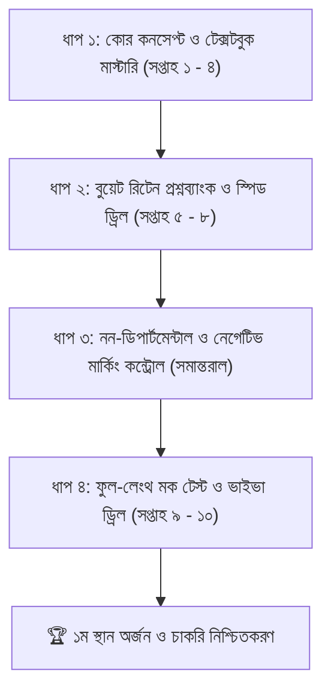

# 🏆 পেট্রোবাংলা ও প্রকৌশল নিয়োগ পরীক্ষা: ১ম স্থান অর্জনের মাস্টার রোডম্যাপ
**রোল:** পার্সোনাল মেন্টর ও গাইড | **লক্ষ্য:** পেট্রোবাংলা ও বিদ্যুৎ-জ্বালানি খাতের নিয়োগ পরীক্ষায় সর্বোচ্চ মেধা স্থান নিশ্চিত করা

---

## 🎯 মেন্টরের প্রারম্ভিক কথা ও দর্শন
চাকরি পরীক্ষায় শুধু "পাস" করার চিন্তা করলে কখনোই চূড়ান্ত তালিকায় শীর্ষস্থান পাওয়া যায় না। বুয়েটের মতো প্রতিষ্ঠানের পরীক্ষায় প্রথম হতে হলে আপনার প্রস্তুতি হতে হবে **সার্জিক্যাল ও নিখুঁত**। 

পরীক্ষায় মেধা তালিকার ফার্স্ট হওয়ার সমীকরণটি খুব সাধারণ:
$$\text{চূড়ান্ত স্কোর} = \underbrace{\text{ডিপার্টমেন্টাল লিখিত (৯০%+ নিশ্চিত)}}\_{\text{পার্থক্য গড়ে দেয়}} + \underbrace{\text{নন-ডিপার্টমেন্টাল MCQ (নেগেটিভ মার্কিং শূন্যের কোঠায়)}}\_{\text{কাট-অফ পার করায়}}$$

অধিকাংশ পরীক্ষার্থী শুধু বিগত সালের প্রশ্ন মুখস্ত করে পরীক্ষা দিতে যায়। কিন্তু আপনি প্রবেশ করবেন **থিওরিটিক্যাল গভীরতা, ক্যালকুলেটরের বিদ্যুৎগতি এবং কাঠামোগত খাতা উপস্থাপনার** মাধ্যমে।

---

## 🗺️ ৪-ধাপের সম্পূর্ণ প্রিপারেশন ফ্রেমওয়ার্ক

---

## 📚 ধাপ ১: ডিপার্টমেন্টাল কোর কনসেপ্ট মাস্টারি (সপ্তাহ ১ - ৪)

প্রতি সপ্তাহে নিচের নির্দিষ্ট অধ্যায় এবং ম্যাথগুলো কোনো শর্টকাট ছাড়া মূল টেক্সটবুক থেকে শেষ করতে হবে:

### সপ্তাহ ১: ইলেকট্রিক্যাল সার্কিট (Alexander & Sadiku)
* **মূল লক্ষ্য:** সার্কিট দেখে ভয় না পাওয়া এবং নোডাল/মেশ দ্রুত সমাধান করা।
* **যেসব টপিক শেষ করতে হবে:**
  1. **Nodal & Mesh Analysis:** অবশ্যই Dependent Source (ডিপেন্ডেন্ট ভোল্টেজ ও কারেন্ট সোর্স) যুক্ত সমস্যাগুলোর সমাধান আয়ত্ত করতে হবে (বুয়েটের সবচেয়ে পছন্দের জায়গা)।
  2. **Network Theorems:** Thevenin’s Theorem, Norton’s Theorem, Maximum Power Transfer Theorem (DC এবং AC উভয় সার্কিটের জন্য: $Z_L = Z_{th}^*$)।
  3. **AC Steady State & Power Analysis:** $S = P + jQ$, Power Factor Improvement (ক্যাপাসিটর ব্যাংক সংযোগের ম্যাথ), Three-Phase Star & Delta Balanced Circuits।
* **প্র্যাকটিস ফিল্টার:** Alexander & Sadiku বইয়ের ৩য়, ৪র্থ, ৯ম, ১১শ এবং ১২শ অধ্যায়ের প্রতিটি উদাহরণ (Solved Examples) নিজে হাতে খাতায় করা।

### সপ্তাহ ২: ইলেকট্রিক্যাল মেশিন (Stephen J. Chapman / B.L. Theraja)
* **মূল লক্ষ্য:** ট্রান্সফরমার এবং মোটরের ভেতরে শক্তির প্রবাহ (Power Flow) সমীকরণ ও ফেজর ডায়াগ্রাম বোঝা।
* **যেসব টপিক শেষ করতে হবে:**
  1. **ট্রান্সফরমার:** সমতুল্য সার্কিট (Equivalent Circuit referred to primary/secondary), ভোল্টেজ রেগুলেশন ফেজর ডায়াগ্রামসহ, অল-ডে এফিশিয়েন্সি এবং ম্যাক্সিমাম এফিশিয়েন্সির ম্যাথ।
  2. **ইন্ডাকশন মোটর (৩-ফেজ):** স্লিপ ক্যালকুলেশন, পাওয়ার ফ্লো অনুপাত ($P_{gap} : P_{cu} : P_{mech} = 1 : s : 1-s$), টর্ক-স্লিপ সমীকরণ এবং স্টার্টিং কারেন্ট নির্ণয়।
  3. **সিনক্রোনাস মেশিন:** অল্টারনেটরের ভোল্টেজ রেগুলেশন (Synchronous Impedance Method), প্যারালাল অপারেশন এবং পাওয়ার সমীকরণ ($P = \frac{E_f V_t}{X_s} \sin \delta$)।
* **প্র্যাকটিস ফিল্টার:** Chapman বইয়ের ২য় এবং ৭ম অধ্যায়; Theraja Vol-2 এর ট্রান্সফরমার ও ইন্ডাকশন মোটর অংশের গাণিতিক উদাহরণ।

### সপ্তাহ ৩: ইলেকট্রনিক্স ও ডিজিটাল লজিক (Boylestad / Sedra-Smith)
* **মূল লক্ষ্য:** অপ-অ্যাম্প সার্কিটের গেইন ও ট্রানজিস্টর বায়াসিং নির্ভুল করা।
* **যেসব টপিক শেষ করতে হবে:**
  1. **Operational Amplifiers (Op-Amp):** Virtual Ground কনসেপ্ট, Inverting, Non-Inverting, Difference Amplifier, Summing Amplifier, Integrator এবং Differentiator সার্কিট।
  2. **ডায়োড ও রেক্টিফায়ার:** Bridge Rectifier, Ripple Factor, PIV ক্যালকুলেশন, Zener Diode ভোল্টেজ রেগুলেশন ম্যাথ।
  3. **BJT ও FET:** DC Biasing, Load Line Analysis, Stability Factor।
  4. **ডিজিটাল লজিক:** Number System Conversion (Binary, Octal, Hexadecimal), Logic Gates simplification, Karnaugh Map (K-map)।

### সপ্তাহ ৪: পাওয়ার সিস্টেম ও প্রোটেকশন (Hadi Saadat / V.K. Mehta)
* **মূল লক্ষ্য:** গ্রিড ক্যালকুলেশন এবং ফল্ট কারেন্ট নিরূপণ।
* **যেসব টপিক শেষ করতে হবে:**
  1. **Per-Unit System:** মাল্টি-ট্রান্সফরমার যুক্ত সিস্টেমের পার-ইউনিট রিঅ্যাক্ট্যান্স ডায়াগ্রাম অঙ্কন এবং নতুন বেসে রূপান্তরের ম্যাথ ($Z_{pu}^{new}$)।
  2. **ট্রান্সমিশন লাইন মডেলিং:** Short, Medium (Nominal-T, Nominal-$\pi$) লাইনের ABCD প্যারামিটার এবং রেগুলেশন।
  3. **ফল্ট অ্যানালাইসিস:** ৩-ফেজ সিমেট্রিক্যাল ফল্ট কারেন্ট এবং Short Circuit MVA ক্যালকুলেশন।
  4. **প্রোটেকশন:** CT, PT অনুপাত, ডিফারেনশিয়াল প্রোটেকশন (ট্রান্সফরমার ও অল্টারনেটরের জন্য)।

---

## ⚡ ধাপ ২: বুয়েট রিটেন স্পিড ড্রিল ও ক্যালকুলেটর প্রোটোকল (সপ্তাহ ৫ - ৮)

বুয়েটের পরীক্ষায় ১টি অংক ভুল হলে সরাসরি ৫ নম্বর কাটা। সময় পাওয়া যায় প্রতি ম্যাথে মাত্র ৪ থেকে ৫ মিনিট।

### ক্যালকুলেটর নিনজা প্রোটোকল (Casio fx-991EX ClassWiz / 991CW)
* **Complex Mode (Mode 2):** এসি সার্কিটের পোলার ($r \angle \theta$) থেকে রেকট্যাঙ্গুলার ($a + jb$) রূপান্তর মাত্র ২ সেকেন্ডে ক্যালকুলেটরে করা শিখতে হবে।
* **Equation Solver (Mode 5 / Polynomial):** মেশ বা নোডাল অ্যানালাইসিসের ৩ চলকের লিনিয়ার সমীকরণ ($3 \times 3$ Matrix) ক্যালকুলেটরে সরাসরি সমাধান করা। খাতায় বড় বড় প্রতিস্থাপন করে সময় নষ্ট করা যাবে না।
* **Sto & Recall Memory (A, B, C, D, X, Y):** বড় বড় ভগ্নাংশের ইন্টারমিডিয়েট মান মেমোরিতে সংরক্ষণ করে চেইন ক্যালকুলেশন করা, যাতে রাউন্ডিং এরর না হয়।

### খাতা উপস্থাপনার ৫টি গোল্ডেন রুল
1. **সার্কিট অবশ্যই পুনরায় আঁকবেন:** প্রশ্নে যে সার্কিট দেওয়া থাকবে, খাতার বাম পাশে পরিচ্ছন্নভাবে স্কেল ছাড়া ফ্রি-হ্যান্ডে দ্রুত এঁকে কারেন্টের দিক ও নোড মার্ক করবেন।
2. **একক (Units) হাইলাইট করা:** প্রতিটি ধাপের উত্তরের পাশে $A, V, \Omega, \text{kVA}, \text{kW}, \text{lagging/leading}$ স্পষ্টভাবে লেখা বাধ্যতামূলক। একক ছাড়া বুয়েটে নম্বর কেটে অর্ধেক করা হয়।
3. **উত্তর বক্স করা:** চূড়ান্ত উত্তরটিকে একটি চারকোনা বক্সের ভেতর রাখবেন (যেমন: $\boxed{V_{th} = 24.5\text{ V}}$)। পরীক্ষকের খাতা মূল্যায়নে এটি ইতিবাচক প্রভাব ফেলে।

---

## 🧠 ধাপ ৩: নন-ডিপার্টমেন্টাল স্কোরিং ইঞ্জিন (দৈনিক ২ ঘণ্টা)

নন-ডিপার্টমেন্টালে ৬০ নম্বরের মধ্যে ৫০+ নম্বর তোলার জন্য নিচের নিয়মে পড়তে হবে:

| বিষয় | কোন বই পড়বেন? | কী কৌশলে পড়বেন? |
| :--- | :--- | :--- |
| **সাধারণ গণিত** | খাইরুল’স বেসিক ম্যাথ | শতকরা, লাভ-ক্ষতি, কাজ-সময়, অনুপাত ও বীজগাণিতিক সূত্র। কোনো অন্ধ শর্টকাট নয়, বেসিক ঐকিক নিয়ম বুঝুন। |
| **ইংরেজি গ্রামার** | Master English (Jahangir Alam) | Subject-Verb Agreement, Right form of verbs, Preposition, Voice, Conditional sentences। |
| **ইংরেজি শব্দভাণ্ডার** | Eminent বই ও বিগত প্রশ্ন | প্রতিদিন সকালে ২০টি Synonyms/Antonyms এবং ১০টি Idioms লিখে লিখে মুখস্ত করা। |
| **বাংলা ব্যাকরণ** | সৌমিত্র শেখর (বা ৯ম-১০ম শ্রেণির ব্যাকরণ) | সন্ধি, সমাস, কারক ও বিভক্তি, ণ-ত্ব ও ষ-ত্ব বিধান। নিয়ম বুঝে শব্দ ভাঙার অনুশীলন। |
| **জ্বালানি ও খনিজ খাত** | পেট্রোবাংলা বার্ষিক প্রতিবেদন ও Eminent (পৃষ্ঠা ৬৭২-৬৮৮) | গ্যাসক্ষেত্রসমূহের নাম, আবিষ্কারের সাল, মজুত, বাপেক্সের খননকৃত কূপ, রূপপুর ও মাতারবাড়ী প্রজেক্টের স্ট্যাটিস্টিক্স। |
| **সাধারণ জ্ঞান (GK)** | এমপিথ্রি বাংলাদেশ ও আন্তর্জাতিক | সংবিধানের গুরুত্বপূর্ণ অনুচ্ছেদ, মুক্তিযুদ্ধ ও মুজিবনগর সরকারের ইতিহাস, আন্তর্জাতিক সংস্থা ও সদর দপ্তর। |

---

## ⏰ দৈনিক রুটিন (The Daily Mentor Schedule)

একজন টপার হতে হলে প্রতিদিন কমপক্ষে ৬–৮ ঘণ্টা শৃঙ্খলাবদ্ধ পড়াশোনা করতে হবে:

* **সকাল (০৬:৩০ - ০৮:৩০) [ব্রেন সতেজ থাকার সময় - ১০০% মুখস্ত অংশ]:**
  * ৩০ মিনিট: পেট্রোবাংলা ও জ্বালানি খাতের তথ্য এবং সাধারণ জ্ঞান।
  * ৪৫ মিনিট: ইংরেজি ভোকাবুলারি, ইডিয়াম ও প্রেপজিশন।
  * ৪৫ মিনিট: বাংলা সাহিত্য ও বাগধারা/সমার্থক শব্দ।
* **দুপুর (১১:০০ - ০১:৩০) [কনসেপচুয়াল গভীরতা - ডিপার্টমেন্টাল থিওরি]:**
  * টেক্সটবুক (Alexander Sadiku / Chapman) খুলে নতুন অধ্যায়ের কনসেপ্ট পড়া এবং ডেরিভেশন বোঝা।
* **বিকেল/সন্ধ্যা (০৫:৩০ - ০৮:০০) [হ্যান্ডস-অন ক্যালকুলেশন - রিটেন ম্যাথ ড্রিল]:**
  * খাতা, কলম ও ক্যালকুলেটর নিয়ে বিগত বুয়েটের লিখিত পরীক্ষার ৮–১০টি গণিত সম্পূর্ণ সমাধান করা।
* **রাত (০৯:৩০ - ১১:০০) [টেস্টিং ও প্রশ্নব্যাংক বিশ্লেষণ]:**
  * Eminent Job Solution বইয়ের ১টি সম্পূর্ণ প্রশ্ন সেট সমাধান করা (MCQ অংশ নিজে দাগিয়ে ভুল উত্তরগুলো কারেকশন খাতায় লিখে রাখা)।

---

## 📝 ভুল সংশোধনের "রেড ডায়েরি" (Error Logbook)

টপারদের সবচেয়ে বড় গোপন অস্ত্র হলো **Error Log Notebook**:
* একটি আলাদা খাতা বানান। 
* প্রতিদিন প্র্যাকটিস করার সময় যে ম্যাথটি আটকে গেল, যে সূত্রে একক ভুল করলেন, বা যে MCQ ভুল দাগালেন—তা সাথে সাথে লাল কলমে ওই খাতায় লিখে রাখবেন।
* প্রতি শুক্রবার রাতে শুধুমাত্র এই ভুলগুলোর খাতা রিভিশন দেবেন। পরীক্ষার আগের রাতে এটি আপনার সবচেয়ে বড় আত্মবিশ্বাস জোগাবে।
